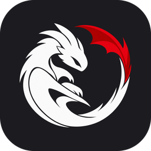
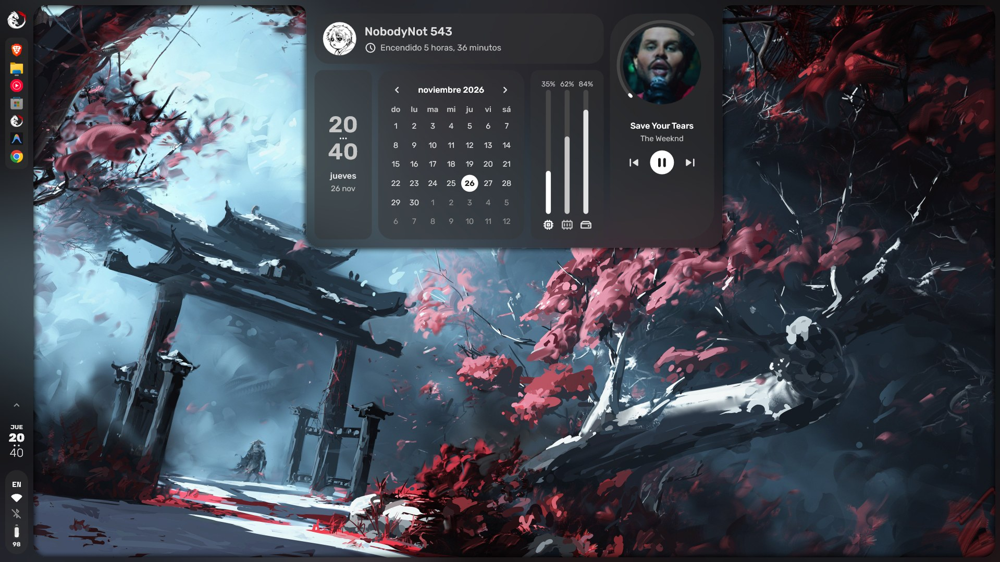

<div align="center">



### Norbanner — una shell de escritorio estilo Caelestia para Windows

  Un marco alrededor de la pantalla, una barra vertical y paneles que salen de
  sus bordes, coloreados con Material You a partir de tu fondo de pantalla.

  [English](README.md) · [Español](README.es.md) · [Français](README.fr.md)

</div>



Norbanner lleva el aspecto y el comportamiento de
[Caelestia](https://github.com/caelestia-dots/shell), la shell de Quickshell
para Hyprland, a Windows 10 y 11. Está escrita en Rust sobre
Direct3D, Direct2D y DirectComposition; comparte el diseño de Caelestia, no su
código.

## Funciones

- **Una sola superficie continua.** Un marco fino rodea cada monitor, con la
  barra a la izquierda. Los paneles forman parte de la misma forma: se funden
  hacia fuera del marco con el movimiento expresivo de Material 3 en lugar de
  aparecer como ventanas. Las ventanas maximizadas quedan dentro del marco.
- **Barra.** Logo (abre el lanzador), escritorios virtuales como espacios de
  trabajo con indicador animado y las apps de cada uno, la ventana activa, los
  iconos ocultos de la bandeja, un reloj vertical, estado de red, Bluetooth,
  batería y Bloq Mayús, y botón de apagado. Desplaza la rueda sobre la barra
  para cambiar de escritorio, el volumen (mitad superior) o el brillo (mitad
  inferior).
- **Panel** (pasa el puntero por el borde superior): tu usuario y tiempo
  encendido, un reloj grande, el mes, medidores de CPU, memoria y disco y lo
  que suena, con controles y un arco de progreso alrededor de la carátula.
- **Lanzador** (toca la tecla Windows o haz clic en el logo): búsqueda difusa
  entre las apps del menú Inicio con sus iconos; escribe `>` para comandos —
  calculadora, selector de fondos, variante del esquema de color,
  claro/oscuro, bloquear, cerrar sesión, suspender, reiniciar, apagar. Las
  cuentas muestran su resultado mientras escribes.
- **Menú de sesión** (botón de apagado): cerrar sesión, apagar, suspender y
  reiniciar, navegable con el teclado.
- **Deslizadores de volumen y brillo** en el borde derecho cuando cambia el
  nivel o al pasar el puntero. El brillo funciona en monitores externos por
  DDC/CI.
- **Material You.** Toda la shell toma sus colores del fondo de pantalla (o
  del color de énfasis de Windows, o uno que elijas), en nueve variantes,
  oscura o clara, y se recolorea al cambiar el fondo.
- **App de Configuración** al estilo de Nexus de Caelestia, en ocho idiomas,
  con vista previa en vivo de los colores. Los cambios se aplican al momento;
  `shell.json` también se puede editar a mano.
- **Programable:** `norbanner shell drawers toggle launcher`, `norbanner shell
  scheme variant vibrant`, `norbanner shell wallpaper set <archivo>`… (ver
  [docs/ARCHITECTURE.md](docs/ARCHITECTURE.md#ipc)).
- Un proceso guardián devuelve la barra de tareas y el área de trabajo si la
  shell se cierra de forma inesperada.

En [docs/ARCHITECTURE.md](docs/ARCHITECTURE.md) está cómo funciona y qué
módulos de Caelestia están hechos y cuáles vienen después.

## Instalar

**[Descargar Norbanner-Setup.exe](https://github.com/NobodyNot543/Norbanner/releases/latest/download/Norbanner-Setup.exe)**
(Windows 10 versión 1903 o posterior, o Windows 11; 64 bits). Se instala solo
para tu usuario, sin permisos de administrador. SmartScreen puede no
reconocerlo aún: elige **Más información → Ejecutar de todas formas**.

## Compilar y ejecutar

Requisitos: Rust con la toolchain MSVC y las Build Tools de C++ de Visual
Studio, Node.js y pnpm.

```powershell
cargo run -p norbanner                 # la shell
cargo run -p norbanner -- --restore    # devolver a mano la barra de tareas y el área de trabajo
```

Para probarla sin ocultar tu barra de tareas, usa una configuración de prueba:

```powershell
'{ "general": { "replaceTaskbar": false, "reserveSpace": false } }' > $env:TEMP\shell.json
$env:NORBANNER_CONFIG = "$env:TEMP\shell.json"; cargo run -p norbanner
```

Configuración:

```powershell
cd apps\settings
pnpm install
pnpm tauri dev
```

## Privacidad

Norbanner no recoge datos ni tiene telemetría. Hace dos peticiones de red,
ambas opcionales:

- Configuración consulta GitHub Releases por una versión nueva al abrirse (se
  desactiva en Configuración → General → *Buscar actualizaciones*).
- Con la isla de letras activada (apagada por defecto; botón de la nota en la
  tarjeta de música del panel), el título, el artista y la duración de la
  canción que suena se envían a [lrclib.net](https://lrclib.net) para buscar
  su letra sincronizada.

## Créditos

Norbanner se construyó a partir de dos proyectos de código abierto:

- **[Muelle](https://github.com/crafter-station/Muelle)** de Crafter Station
  y colaboradores (MIT): la base de código para Windows de la que partió
  Norbanner.
- **[Caelestia](https://github.com/caelestia-dots/shell)** de soramane y
  colaboradores: el diseño que sigue Norbanner.

Fuentes: [Rubik](https://fonts.google.com/specimen/Rubik)
(OFL) y [Material Symbols](https://fonts.google.com/icons) (Apache 2.0).
Ciencia del color: [material-colors](https://crates.io/crates/material-colors).

## Licencia

[MIT](LICENSE)
